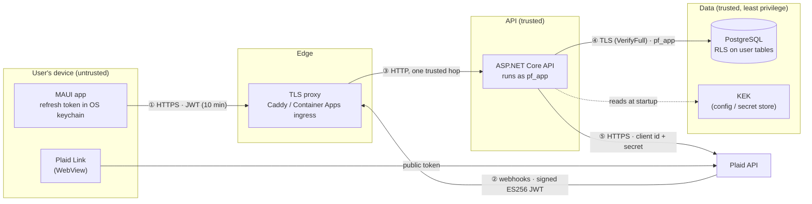

# Threat model

A short, honest threat model for the Personal Finance API as of 0.3.0
(#126): what's worth stealing, where the trust boundaries are, what stops
each threat, and what's knowingly left open. Every mitigation points to
the code or doc that implements it.

## What we protect

| Asset | Why it matters | Where it lives |
|---|---|---|
| **Plaid access tokens** | Long-lived read access to someone's bank accounts | `Accounts.PlaidAccessToken`, envelope-encrypted |
| **Financial data** | Balances, every transaction, net worth: private and sensitive | `Transactions`, `Accounts`, `BalanceSnapshots`, `Budgets`, `CategoryRules` |
| **Credentials and sessions** | Account takeover | Password hashes, refresh-token hashes, TOTP secrets, recovery codes |
| **Key-encryption key (KEK)** | Decrypts every stored Plaid token and TOTP secret | Configuration (platform secret store), never the database |
| **Audit trail** | Evidence of what happened | `AuditEvents` |

## Trust boundaries

1. **Client → API**: everything the client sends is untrusted, and it
   authenticates with a short-lived JWT.
2. **Plaid → API (webhooks)**: anonymous on the network, so the payload
   is trusted only after signature verification.
3. **Proxy → API**: forwarded headers are trusted only from this one hop,
   and only when configured.
4. **API → database**: the API is not trusted to filter correctly on its
   own. The database enforces isolation too.
5. **API → Plaid**: outbound only. Secrets never reach the client.

## Threats and mitigations (STRIDE)

### Spoofing

| Threat | Mitigation | Code |
|---|---|---|
| Password guessing / credential stuffing | Per-IP rate limit on auth endpoints. **Account lockout** (5 wrong passwords or codes → 15 min). Optional **TOTP MFA** | `AddRateLimitingSetup`, `AuthEndpoints`, `MfaEndpoints` (#117) |
| Stolen password | TOTP second factor. One-time recovery codes. Codes can't be replayed (3-minute memory) | `TotpVerifier` (#117) |
| Forged webhook triggering syncs | `Plaid-Verification` JWT: **ES256 only** (rejects `none`/HS256 confusion), current Plaid key by `kid`, **≤ 5 min old**, **body SHA-256 bound**, constant-time compare | `PlaidWebhookVerifier` (#118) |
| Spoofed client IP via `X-Forwarded-For` | Forwarded headers honoured only with `ReverseProxy:Enabled`, from one hop. Caddy strips client-sent values | `HttpsHardening` (#123) |

### Tampering

| Threat | Mitigation | Code |
|---|---|---|
| Traffic modified in transit | HTTPS-only outside dev, **HSTS 1 year**, TLS to Postgres with `VerifyFull` | `HttpsHardening`, `infra/main.bicep` (#123) |
| Swapping a ciphertext into another user's row | AES-GCM with the **owning user as associated data**: it won't decrypt there | `EnvelopeEncryptor`, `PlaidTokenProtector` (#120) |
| Editing or deleting audit evidence | `pf_app` has no `UPDATE/DELETE/TRUNCATE` on `AuditEvents`, and a trigger blocks even the owner | `AuditEvents` + `RowLevelSecurity` migrations (#116, #119) |
| Duplicate or replayed sync pages corrupting balances | Per-Item row lock, upserts on the unique Plaid id, cursor committed atomically with its changes | `PlaidSyncService` (#114) |

### Repudiation

| Threat | Mitigation | Code |
|---|---|---|
| "I never logged in / linked that bank" | Append-only audit log of logins, failures, token reuse, logout, MFA changes, bank link/unlink and rejected webhooks, with IP and user agent. Users see their own events (`GET /audit`, Security page) | `AuditLog` (#116) |
| No trail across services | Structured logs with trace ids, OpenTelemetry traces through API → Plaid → Postgres | `ObservabilityExtensions` (#121) |

### Information disclosure

| Threat | Mitigation | Code |
|---|---|---|
| **One user reading another's data** (a missed `WHERE`, a stray `IgnoreQueryFilters()`, raw SQL) | Two layers: EF query filters that fail closed, **and Postgres row-level security** (`FORCE`d) with the API as non-superuser `pf_app`. Startup refuses to run in Production as a role that bypasses RLS | `AppDbContext`, `RlsSessionInterceptor`, `DatabaseRoleCheck` (#56, #119) |
| Database dump or backup leaks | Plaid tokens, TOTP secrets and recovery codes are **envelope-encrypted** with a KEK held outside the DB. Refresh tokens stored as SHA-256 hashes. Passwords hashed (PBKDF2) | `EnvelopeEncryptor`, `ProtectedUserStore`, `TokenService` (#115, #120) |
| XSS stealing a browser session | Refresh token in an `HttpOnly; Secure; SameSite=Strict` cookie scoped to `/api/v1/auth`. A 10-minute access token kept in memory | `RefreshTokenCookie` (#115) |
| Secrets in logs or traces | Request logs carry the path, never the query string (SignalR's `access_token`). Spans drop `url.query`. No headers or bodies logged. Audit events never hold tokens or typed emails | `ObservabilityExtensions`, `AuditLog`, `TelemetryTests` (#121) |
| Plaid secrets reaching the client | All Plaid calls server-side. The client only handles a link token and a one-time public token | `PlaidEndpoints` |
| Existence of other users' records | Another user's account, transaction or rule is a `404`, not a `403` | RLS (#119) |

### Denial of service

| Threat | Mitigation | Code |
|---|---|---|
| Request floods | Global per-IP rate limit (200/min). Stricter on auth (10/min) | `AddRateLimitingSetup` |
| Oversized webhook bodies | 64 KB cap → `413` | `PlaidEndpoints` (#118) |
| Webhook storms | Syncs queued and deduplicated per Item, answered `200` immediately | `PlaidItemSyncQueue` (#118) |
| Known-vulnerable dependencies | CI fails on any vulnerable NuGet package (it caught CVE-2026-70159 in this release) | `ci.yml`, `scripts/test.sh` (#128) |

### Elevation of privilege

| Threat | Mitigation | Code |
|---|---|---|
| Stolen refresh token used alongside the real client | Rotation on every use. **Reuse of a rotated token revokes that session's family** and is audited. Concurrent refreshes can't both win | `TokenService` (#115) |
| Stolen access token used to disable MFA | `/auth/mfa/disable` needs a current TOTP or recovery code | `MfaEndpoints` (#117) |
| The app changing schema or disabling RLS | `pf_app` has DML only: no DDL, no `ALTER TABLE … DISABLE ROW LEVEL SECURITY` | `RowLevelSecurity` migration (#119) |
| Container breakout impact | Runs as an unprivileged user (uid 1654), nothing published except through the proxy | `Dockerfile`, `docker-compose.prod.yml` (#122, #123) |

## Accepted risks (and what would close them)

| Risk | Why it's accepted for now | Fix |
|---|---|---|
| **KEK in configuration**, not an HSM | No paid services. Anyone who gets both the platform secrets and a DB copy can decrypt | Azure Key Vault / KMS provider behind `IKeyEncryptionKeyProvider` ([KEY_MANAGEMENT.md](KEY_MANAGEMENT.md#production-upgrade-a-managed-kms)) |
| **`app.rls_bypass` is a session setting** | SQL injection as `pf_app` could set it. There's no string-built SQL (EF parameterises everything) | A separate `BYPASSRLS` role for system jobs (needs a superuser, which managed Postgres doesn't give) |
| **Access tokens can't be revoked** | Bounded to 10 minutes | A deny-list keyed on `jti`, if ever needed |
| **Refresh tokens rotate in place, no device binding** | Reuse detection catches parallel use, but not a thief who uses a token *first* while the real client is offline | DPoP / sender-constrained tokens (RFC 9449) |
| **Rate limits are per instance and in memory** | One replica today | Distributed limiter (Redis) when scaling out |
| **Database reachable by any Azure service** | The "allow Azure services" firewall rule, not private networking | VNet integration + private access (`docs/DEPLOYMENT.md`) |
| **No email verification or password reset** | Demo scope | Identity's confirmation and reset flows |
| **The offline transaction cache on the device isn't encrypted** | The first page of transactions, on the user's own device | Encrypt with a key from SecureStorage |
| **Plaid sandbox only** | Production access needs Plaid's security review | (Plaid production onboarding) |

## Reviewing this

Re-read it when a change crosses a boundary above: a new endpoint that
takes anonymous input, a new table holding user data (it needs the query
filter **and** an RLS policy, and `RowLevelSecurityTests` should cover it),
a new secret (envelope-encrypt it), or anything new in logs.
